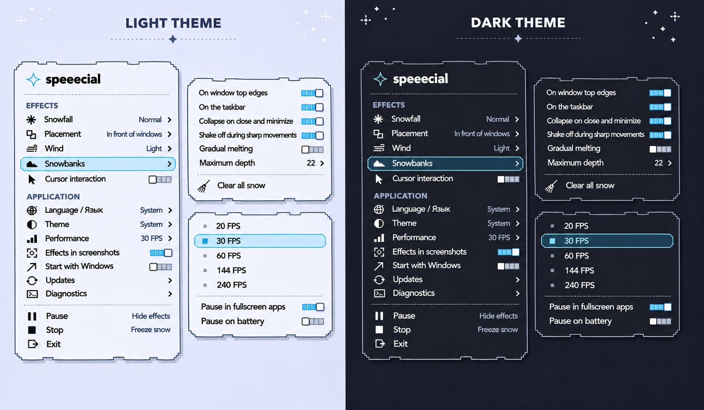

  

<h1 align="center">speeecial</h1>

<strong>snow desktop</strong> · a little winter on your Windows desktop

<a href="README.md">Russian</a> · <strong>English</strong>

Snowflakes drift across your screen, and snowbanks grow along the top edges of windows and the taskbar. Minimize a window and its snow falls away. Move it sharply to shake off part of its snow cap.

The app lives in the system tray, with every setting available from one compact menu. Snow overlays let clicks pass through and keep your windows usable.

## Features

- **Adjustable snowfall.** From a few snowflakes to a blizzard, in front of windows or behind them.
- **Snowflake size.** A dedicated slider row in **Snowfall** adjusts the average size from 2 to 12 (default 6). Drag the slider or use the left/right arrow keys; changes apply immediately and are saved when the menu closes. Larger snowflakes build snowbanks faster.
- **Snow on windows and the taskbar.** Enable each independently, choose from three maximum depths, and let snow melt gradually.
- **Collapsing and shaken-off snow.** Snow falls when windows close or minimize, shakes loose during sharp movements, and settles on available surfaces below.
- **Wind and cursor interaction.** Choose calm, gentle, or gusty wind, and optionally let pointer movement affect snowflakes.
- **Multiple monitors.** Supports different display scales and screen arrangements.
- **Performance controls.** Limit updates to 20, 30, 60, 144, or 240 FPS, with automatic pauses for fullscreen apps and battery use.
- **Updates from GitHub Releases.** Checks at startup at most once a day, with manual checks and installation on your command, right from the tray.
- **Menu themes.** Follows the Windows theme by default, with manual light and dark options. Pixel borders, icons, and switches, a readable font, current values beside menu items, and mouse and keyboard navigation.
- **Menu language.** Russian or English, with manual selection. Uses the Windows display language by default, falling back to English for other languages.

Snow effects work offline. An internet connection is only needed to check for and download updates; automatic checks can be disabled. No account, installer, or administrator rights are required.

## Getting started

1. Run `speeecial.exe`.
2. Find the ice star in the system tray. Windows may place it in the hidden icons area.
3. Left-click or right-click the icon and choose your effects.

To try it out, select **Snowfall → Blizzard** and open a regular window with some space above it. Let snow accumulate, then minimize the window.

## Controls

The menu supports English and Russian. Choose **Language** to follow the system language (default) or select Russian or English explicitly. Your choice is saved between sessions.

| Section | What you can adjust |
|---|---|
| **Snowfall** | Stop new snowflakes or choose light, normal, or blizzard snowfall |
| **Placement** | Show falling snow in front of windows or behind them |
| **Wind** | Choose calm, gentle, or gusty wind |
| **Snowbanks** | Enable snow on windows and the taskbar, collapsing, shaking, and melting; choose the depth or clear the snow |
| **Cursor interaction** | Deflect snowflakes with pointer movement |
| **Performance** | Limit FPS and enable automatic pauses |
| **Theme** | System (default), light, or dark menu theme |
| **Language** | System (default), Russian, or English |
| **Effects in screenshots** | Control snow visibility in compatible capture tools |
| **Start with Windows** | Launch the app when you sign in |
| **Updates** | Check for a new version, enable automatic checks, install an update, or open the releases page |
| **Diagnostics** | Restore graphics, save a report, or open the settings and log folder |

Hover over the menu header to see the particle count and selected FPS limit.

### Pause and stop

| Action | Result |
|---|---|
| **Pause** | Hides effects while snow movement, accumulation, and melting continue |
| **Stop** | Hides effects and freezes the simulation, preserving accumulated snow |
| **Exit** | Closes the app completely |

Select the active mode again to resume normal operation. To remove only accumulated snow, use **Snowbanks → Clear all snow**.

## Settings and updates

Settings are saved automatically to `%LOCALAPPDATA%\SnowDesk\settings.ini`. Open the folder through **Diagnostics → Settings and log folder**. The legacy folder name is retained for compatibility with earlier versions.

Open **Updates → Check for updates**. If a newer version is available, an **Update to …** command appears: the app downloads the file, verifies it, and restarts. Automatic checks are enabled by default and run at startup at most once a day; installation is never automatic. Only stable releases are considered.

Built-in installation requires a writable folder containing the EXE. If the release has no suitable file or Windows prevents replacement, use **Updates → Releases on GitHub**: exit the app, download the new version, and replace the EXE manually. Versions 1.0.9 and earlier require a one-time manual update.

Your settings are preserved; snowbank shapes are not saved between sessions. The automatic update check setting is stored separately in `%LOCALAPPDATA%\SnowDesk\updates.ini`. If startup with Windows is enabled, the app updates the registered path to its current EXE. If an updated version fails to start successfully, the updater can restore the previous EXE.

To uninstall, disable startup with Windows, exit the app, and delete the EXE. You can delete the settings folder separately.

## Compatibility

- Windows 10 version 2004 or later, or Windows 11, x64.
- A Direct3D 11-capable graphics card and the standard Explorer desktop.
- Snow accumulation on window edges is designed for regular windows. Maximized and fullscreen windows do not get snow caps.
- The taskbar snowbank hides with the taskbar. Accumulation is designed for a horizontal taskbar; third-party shells and custom taskbars are not specifically supported.
- Hiding effects from captures depends on the capture method. It does not guarantee that snow will be excluded from every screenshot or recording.

If effects stop appearing, check manual and automatic pauses. Use **Diagnostics → Recreate graphics** to restore rendering. When reporting an error, you can attach a report from the same menu section.

---

[Changelog](CHANGELOG.md) · [Developer documentation](docs/BUILDING.md) · [Architecture](docs/ARCHITECTURE.md) (linked documents are in Russian)
