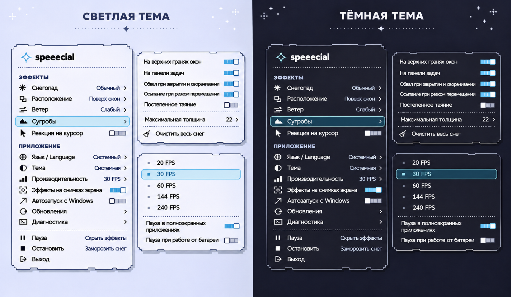

  

<h1 align="center">speeecial</h1>

<strong>snow desktop</strong> · немного зимы на рабочем столе Windows

<strong>Русский</strong> · <a href="README.en.md">English</a>

Снежинки летят по экрану, на верхних гранях окон и панели задач растут сугробы. Сверни окно — снег осыплется вниз. Резко передвинь его — часть снежной шапки стряхнётся.

Приложение живёт в системном трее: все настройки доступны из одного компактного меню. Снежные слои не перехватывают клики и не мешают работать с окнами.

## Возможности

- **Настраиваемый снегопад.** От нескольких снежинок до метели; поверх окон или за ними.
- **Размер снежинок.** В подменю «Снегопад» отдельная строка с ползунком меняет средний размер от 2 до 12 (по умолчанию 6). Перетаскивай ползунок или используй стрелки влево/вправо; размер применяется сразу и сохраняется при закрытии меню. Крупные снежинки быстрее наращивают сугробы.
- **Снег на окнах и панели задач.** Независимое включение, три значения максимальной толщины и постепенное таяние.
- **Обвалы и стряхивание.** Снег падает при закрытии и сворачивании окон, осыпается при резком движении и оседает на доступных поверхностях ниже.
- **Ветер и курсор.** Штиль, слабый или порывистый ветер; по желанию снежинки реагируют на движение указателя.
- **Несколько мониторов.** Поддержка разных масштабов интерфейса и расположений экранов.
- **Управление нагрузкой.** Лимит 20, 30, 60, 144 или 240 FPS, автоматическая пауза для полноэкранных приложений и при работе от батареи.
- **Обновления из GitHub Releases.** Проверка при запуске не чаще раза в сутки, ручная проверка и установка по твоему нажатию — прямо из трея.
- **Тема меню.** По умолчанию следует теме Windows; светлую или тёмную можно выбрать вручную. Пиксельные рамки, значки и переключатели, обычный читаемый шрифт, выбранные значения рядом с пунктами, управление мышью и клавиатурой.
- **Язык меню.** Русский или английский, с ручным выбором. По умолчанию используется язык интерфейса Windows; для остальных языков — английский.

Снежные эффекты работают без интернета. Подключение нужно только для проверки и загрузки обновлений; автоматическую проверку можно выключить. Учётная запись, установщик и права администратора не требуются.

## Как пользоваться

1. Запусти `speeecial.exe`.
2. Найди ледяную звезду в системном трее. Windows может поместить её в область скрытых значков.
3. Нажми на значок левой или правой кнопкой мыши и выбери нужные эффекты.

Для первого знакомства включи **«Снегопад → Метель»** и открой обычное окно с небольшим свободным пространством над ним. Дай снегу накопиться, затем сверни окно.

## Управление

| Раздел | Что можно настроить |
|---|---|
| **Снегопад** | Выключить новые снежинки или выбрать слабый, обычный снегопад либо метель |
| **Расположение** | Показывать летящий снег поверх окон или за ними |
| **Ветер** | Выбрать штиль, слабый или порывистый ветер |
| **Сугробы** | Включить снег на окнах и панели задач, обвалы, стряхивание и таяние; выбрать толщину или очистить снег |
| **Реакция на курсор** | Отклонять снежинки движением указателя |
| **Производительность** | Ограничить FPS и включить автоматические паузы |
| **Тема** | Системная (по умолчанию), светлая или тёмная тема меню |
| **Язык / Language** | Системный (по умолчанию), русский или английский; выбор сохраняется после перезапуска |
| **Эффекты на снимках экрана** | Управлять видимостью снега в совместимых средствах захвата |
| **Автозапуск с Windows** | Запускать приложение при входе в систему |
| **Обновления** | Проверить новую версию, включить автоматическую проверку, установить обновление или открыть релизы |
| **Диагностика** | Восстановить графику, записать отчёт или открыть папку настроек и журнала |

Наведи курсор на заголовок меню, чтобы увидеть количество частиц и выбранный лимит FPS.

### Пауза и остановка

| Действие | Результат |
|---|---|
| **Пауза** | Скрывает эффекты; движение снега, накопление и таяние продолжаются |
| **Остановить** | Скрывает эффекты и замораживает симуляцию, сохраняя накопленный снег |
| **Выход** | Полностью завершает приложение |

Повторное нажатие на выбранный режим возобновляет обычную работу. Чтобы убрать только уже накопленный снег, используй **«Сугробы → Очистить весь снег»**.

## Настройки и обновление

Параметры сохраняются автоматически в `%LOCALAPPDATA%\SnowDesk\settings.ini`. Папку можно открыть через **«Диагностика → Папка настроек и журнала»**. Старое имя каталога сохранено для совместимости с предыдущими версиями.

Открой **«Обновления → Проверить обновления»**. Если доступна новая версия, появится команда **«Обновить до …»**: приложение скачает файл, проверит его и перезапустится. Автоматическая проверка включена по умолчанию и выполняется при запуске не чаще раза в сутки; автоматической установки нет. Учитываются только стабильные релизы.

Для встроенной установки нужна доступная для записи папка с EXE. Если подходящего файла в релизе нет или Windows запрещает замену, используй **«Обновления → Релизы на GitHub»**: заверши приложение, скачай новую версию и замени EXE вручную. С версий 1.0.9 и старше нужно один раз обновиться вручную.

Настройки сохранятся; форма сугробов между запусками не сохраняется. Параметр автоматической проверки хранится отдельно в `%LOCALAPPDATA%\SnowDesk\updates.ini`. Если автозапуск включён, приложение обновит путь к своему текущему EXE. При неудачном запуске обновления предусмотрен возврат предыдущего EXE.

Для удаления выключи автозапуск, заверши приложение и удали EXE. Папку настроек можно удалить отдельно.

## Совместимость

- Windows 10 версии 2004 и новее или Windows 11, x64.
- Видеокарта с поддержкой Direct3D 11 и стандартный рабочий стол Explorer.
- Снег на гранях рассчитан на обычные окна. На развёрнутых и полноэкранных окнах снежные шапки не образуются.
- Сугроб панели задач скрывается вместе с ней. Накопление рассчитано на горизонтальную панель; сторонние оболочки и нестандартные панели отдельно не поддерживаются.
- Скрытие эффектов на снимках зависит от способа захвата. Оно не гарантирует исключения снега из любого скриншота или видеозаписи.

Если эффекты перестали отображаться, проверь ручную и автоматическую паузы. Для восстановления отрисовки доступна команда **«Диагностика → Пересоздать графику»**. При сообщении об ошибке можно приложить отчёт из той же группы меню.

---

[История изменений](CHANGELOG.md) · [Документация для разработчиков](docs/BUILDING.md) · [Архитектура](docs/ARCHITECTURE.md)
